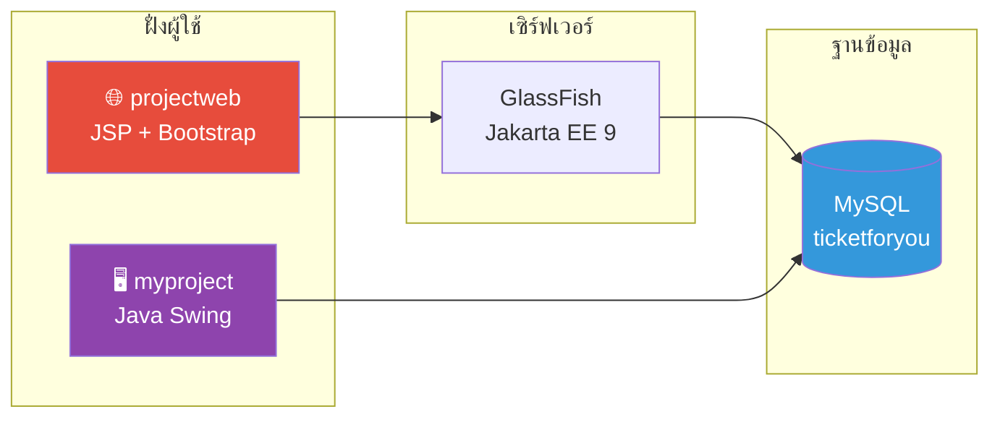

<div align="center">

# 🎟️ TicketForYou

**ระบบจองตั๋วชมการแข่งขันออนไลน์**  
โปรเจกต์วิชา INT4102 — ประกอบด้วยเว็บไซต์สำหรับลูกค้า และแอป Desktop สำหรับผู้ดูแลระบบ

<br>


</div>

---

## 📌 เกี่ยวกับโปรเจกต์

**TicketForYou** เป็นระบบจองตั๋วชมการแข่งขันกีฬา (เน้นฟุตบอล) ที่แบ่งออกเป็น 2 ส่วนหลัก ทำงานร่วมกันผ่านฐานข้อมูล MySQL ชื่อ `ticketforyou`

| ส่วน | โฟลเดอร์ | ผู้ใช้งาน | หน้าที่ |
|:----:|:--------:|:---------:|:--------|
| 🌐 **เว็บไซต์** | [`projectweb/`](projectweb/) | ลูกค้าทั่วไป | ดูรายการแข่งขัน · สมัครสมาชิก · สั่งซื้อตั๋ว · ดูประวัติการสั่งซื้อ |
| 🖥️ **Desktop Admin** | [`myproject/`](myproject/) | ผู้ดูแลระบบ | จัดการพนักงาน · จัดการรายการตั๋ว · ดูคำสั่งซื้อทั้งหมด |

---

## 🏗️ สถาปัตยกรรมระบบ



### ตารางในฐานข้อมูล

| ตาราง | ใช้โดย | เก็บข้อมูล |
|:------|:-------|:-----------|
| `ticket` | ทั้งสองส่วน | รายการแข่งขัน / ตั๋ว |
| `customer` | projectweb | บัญชีลูกค้า |
| `myorder` | ทั้งสองส่วน | คำสั่งซื้อตั๋ว |
| `employee` | myproject | ข้อมูลพนักงาน |

---

## 🛠️ เทคโนโลยีที่ใช้

<table>
<tr>
<td align="center" width="50%">

### 🌐 projectweb — เว็บแอปพลิเคชัน

| เทคโนโลยี | รายละเอียด |
|:----------|:-----------|
| **Backend** | Java 17 · JSP · Jakarta EE 9 |
| **Frontend** | Bootstrap · jQuery · Font Awesome |
| **Server** | GlassFish (NetBeans) |
| **Database** | MySQL · Connector/J 8.0.28 |

</td>
<td align="center" width="50%">

### 🖥️ myproject — Desktop Admin

| เทคโนโลยี | รายละเอียด |
|:----------|:-----------|
| **Language** | Java 17 |
| **GUI** | Java Swing (NetBeans Form Editor) |
| **Build** | Maven |
| **Database** | MySQL · Connector/J 8.0.28 |

</td>
</tr>
</table>

---

## 📁 โครงสร้างโปรเจกต์

```
int4102/
│
├── 📄 README.md              ← คุณอยู่ที่นี่
│
├── 🌐 projectweb/            ← เว็บไซต์สำหรับลูกค้า
│   ├── README.md
│   └── web/
│       ├── index.jsp         # หน้าหลัก
│       ├── showdata.jsp      # รายละเอียด + สั่งซื้อ
│       ├── buyticket.jsp     # บันทึกคำสั่งซื้อ
│       ├── login.jsp         # เข้าสู่ระบบ
│       ├── registration.jsp  # สมัครสมาชิก
│       ├── myorder.jsp       # รายการของฉัน
│       └── css/ · js/        # Bootstrap, jQuery
│
└── 🖥️ myproject/             ← แอป Desktop สำหรับ Admin
    ├── README.md
    └── src/main/java/com/mycompany/myproject/
        ├── loading.java      # หน้าโหลด (จุดเริ่มต้น)
        ├── Home.java         # หน้าหลัก
        ├── add/update/delete employee · ticket
        └── orderticket.java  # ดูคำสั่งซื้อ
```

---

## 🚀 เริ่มต้นใช้งาน

### ความต้องการของระบบ

- ☕ **JDK 17** ขึ้นไป
- 🐬 **MySQL Server** + ฐานข้อมูล `ticketforyou`
- 🐠 **GlassFish Server** (สำหรับ projectweb)
- 🔧 **NetBeans IDE** (แนะนำ) หรือ Maven CLI

### Quick Start

**1. ตั้งค่าฐานข้อมูล**
> สร้างฐานข้อมูล `ticketforyou` และปรับ connection string ในไฟล์ Java / JSP ให้ตรงกับเครื่องของคุณ

**2. รันเว็บไซต์ (projectweb)**
```bash
# Deploy บน GlassFish แล้วเปิด
http://localhost:8080/projectweb/
```
📖 รายละเอียดเพิ่มเติม → [`projectweb/README.md`](projectweb/README.md)

**3. รัน Desktop Admin (myproject)**
```bash
cd myproject
mvn clean package
mvn exec:java -Dexec.mainClass="com.mycompany.myproject.loading"
```
📖 รายละเอียดเพิ่มเติม → [`myproject/README.md`](myproject/README.md)

---

## 🔄 Flow การทำงาน

```
ลูกค้าเข้าเว็บ → ดูรายการแข่งขัน → เข้าสู่ระบบ → สั่งซื้อตั๋ว
                                                    ↓
                                          บันทึกลง myorder
                                                    ↓
Admin เปิด Desktop → ดูคำสั่งซื้อ / จัดการตั๋ว / จัดการพนักงาน
```

---

<div align="center">

<br>

**INT4102 · TicketForYou**  
*ระบบจองตั๋วครบวงจร — จากหน้าร้านสู่หลังบ้าน*

</div>
